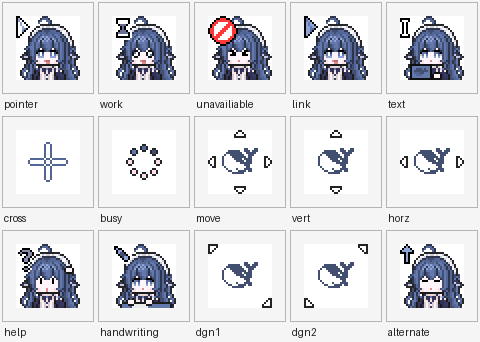

# dsh-independent-input

把「操作鼠标键盘」这件事从悬浮球里单独拆出来的 DSH 插件。

它只提供一组输入工具（`independent_input`），不包含悬浮球、语音、头像、预设或后台会话。
默认**不移动主人的真实光标、不抢键盘焦点**：点击/滚动/拖拽必须带目标窗口 `hwnd`，只向那个窗口发
UIA / 窗口消息；**click / scroll / drag 严格禁止 physical 鼠标**。只有 `type` / `key` 的 physical 键盘
（不碰鼠标）还可以用。physical 不会因为主人动鼠标键盘自动暂停，只有 **Ctrl+Alt+Q** 显式暂停。

设置页有**总开关**：关掉后插件不执行任何动作；开着时 AI 光标和主人的鼠标完全分开——AI 光标只是覆盖层，
点击走目标 `hwnd`，主人的鼠标不动、也不抢前台。

> Windows 只有一个系统光标和一个键盘焦点，不存在两套真正并行的“系统鼠标”。
> 所以这里的“独立”指的是：**不占用主人那套光标/焦点**，而不是再装一个驱动。

## 能力

| action | 做什么 | 默认通道 |
| --- | --- | --- |
| `status` | 是否暂停、主人最近输入、真实光标、前台窗口、AI 光标 | 只读 |
| `windows` | 列可见顶层窗口（hwnd / 标题 / 矩形 / 进程） | 只读 |
| `capture` | 截当前前台窗口（或指定 rect / full），图直接附在工具结果里 | 只读 |
| `click` | 单击 / 双击 / 右键 | UIA → 窗口消息 |
| `type` | 输入文字（追加或覆盖） | UIA Value → `WM_SETTEXT` → 消息聚焦 + `WM_CHAR` |
| `key` | 组合键（`ctrl+c`、`alt+tab`、`enter`…） | 窗口消息 或 物理 |
| `scroll` | 滚轮 | UIA Scroll → 窗口消息 |
| `drag` | 拖拽 | 窗口消息 或 物理 |
| `move` | 只移动 AI 光标（覆盖层），真实光标不动 | 覆盖层 |
| `pause` / `resume` | 暂停 / 恢复输入 | 本地状态 |
| `overlay` | 显示 / 隐藏 / 切换光标模式 | 覆盖层 |

## AI 光标：陪伴 / 整洁

AI 光标用的是主人给的这套 64×64 动态光标素材（`assets/cursors/*.png`，由 `.ani` 拆帧合成），
默认是 **24 帧、60ms/帧** 的小人光标；暂停时换成红色「禁止」那只。
素材来自作者提供的 .ani 素材包（15 只，对应同一只光标的 15 个状态），
只做插件内覆盖层，不改系统鼠标、不装驱动。

两种模式，可以在 `cordis.patch.yml` 里选，也可以运行时用工具切：

```yaml
- insert:
    - id: independent-input
      name: dsh-independent-input
      config:
        cursorMode: companion   # companion（默认，一直显示）| clean（动作后自动收起）
        cursorHoldMs: 2600      # clean 模式收起前停留多少毫秒
        cursorSize: 64           # AI 光标边长像素，24–192
```

- **companion（陪伴）**：`move` 之后一直显示，点击/输入/滚动后也回来，直到
  `overlay({show:false})` 或任务结束；暂停时变红。
- **clean（整洁）**：每次动完显示 `cursorHoldMs` 毫秒就自动收起；适合不想让光标一直占屏。
- 运行时切换：`independent_input({action:"overlay", cursorMode:"clean"})` /
  `...cursorMode:"companion"`；大小用 `cursorSize`（24–192，默认 64）：
  `overlay({cursorSize:96})`。`overlay({show:false})` 收起，`move({x,y})` 再叫出来。
- **光标状态是自动切换的**，不是让你挑样式：这些是同一只光标的 15 个状态
  （`pointer` / `work` / `unavailiable` / `link` / `text` / `cross` / `busy` / `move` /
  `vert` / `horz` / `help` / `handwriting` / `dgn1` / `dgn2` / `alternate`），
  插件按操作自己换：普通移动/点击用 pointer，输入用 text，点到可点元素用 link，
  上下滚用 vert，横向/竖向拖拽用 horz/vert，拖动用 move，斜向拖拽用 dgn1/dgn2，
  精确物理点击用 cross，暂停用 unavailiable，失败用 help。



AI 光标是置顶、点击穿透、不抢焦点的窗口；素材热点在左上角，所以箭头尖就是动作坐标。
截图时 sidecar 会短暂收起它、截完再放回，避免挡住目标。

## 总开关与目标窗口

- 设置页顶部「启用独立输入」：关掉后插件不执行任何动作；开着时 AI 光标和主人的鼠标/输入焦点完全分开。
- `click` / `type` / `key` / `scroll` / `drag` **必须带目标 `hwnd`**（先用 `windows` 拿）。
  插件只向这个窗口发 UIA / 窗口消息，不按屏幕坐标碰运气，也不抢前台/输入框。
- `physical` 已禁用：真实鼠标会动光标，真实键盘会抢焦点；需要独立操作时不用它。

## 三种模式

- `auto`（默认）：目标 `hwnd` 的 UIA → 窗口消息。**不动真实光标、不抢输入焦点**。
- `uia`：UIA 优先，失败后同样允许落到目标窗口消息。
- `message`：只发目标窗口消息。

## 主人的暂停权

- **Ctrl+Alt+Q**：全局热键，随时切换暂停/恢复（`RegisterHotKey`）。
- 只有显式暂停（热键 / `pause`）才会中断后续动作；主人在用键鼠不再自动触发暂停。
- 暂停后，`click` / `type` / `key` / `scroll` / `drag` 一律拒绝执行并返回 `paused:true`；
  模型必须停下，等主人说“继续”再 `action:"resume"`。
- AI 光标是置顶、点击穿透、不抢焦点的 24 帧小人光标；陪伴模式一直显示，整洁模式动作后收起；
  暂停时变成红色「禁止」光标。截图里也能看到，方便核对目标。

## 安装

在 `~/.dsh/profiles/desktop/package.json` 的 `dependencies` 里加：

```json
"dsh-independent-input": "link:E:/path/to/dsh-independent-input"
```

并把 `dsh-independent-input` 加进 `dsh.profile.bundles`。然后：

```powershell
dsh plugin --profile desktop install
```

重启 DSH 后，主窗口会话里会出现 `independent_input` 工具。

## 设置页（推荐）

重启 DSH 后打开 **设置 → 独立输入**：

- **显示方式**：陪伴（一直显示）/ 整洁（动作后收起，可调停留毫秒）；
- **光标状态**：自动切换（设置页只展示 15 个状态和触发场景，不用手选）；
- **光标大小**：滑杆 / 数字 24–192；
- **保存并生效**：立即写到 sidecar，不需要重启；
- **在屏幕上试一下 / 收起光标**：直接看效果；
- **恢复默认**：陪伴 · 64px · 2600ms。

设置页保存到 `~/.dsh/independent-input/settings.json`，优先级高于
`cordis.patch.yml` 里的默认值；删掉这个 JSON 或点“恢复默认”就回到插件默认。

## 自测

不经过 DSH，直接跑 sidecar 的端到端测试：

```powershell
node test/input-test.mjs
```

它会启动一个 WinForms 测试窗口，验证：

- 窗口消息点击（不移动光标）能真的点到按钮；
- UIA 失败后自动落到窗口消息，也能点到；
- `WM_SETTEXT` 能写入 Edit 控件（不聚焦、不移动光标）；
- AI 光标置顶且可被截图捕获。

## 结构

```
index.js          DSH 工具注册 + 结果格式化 + 截图附件 + 设置页 HTTP API
client.js         设置 → 独立输入（React 客户端 chunk，无构建）
lib/engine.js     sidecar 客户端（懒启动、JSON 行协议、超时/重启）
sidecar.ps1       Windows PowerShell 5.1 STA：C# P/Invoke + UIA + 窗口消息 + 钩子 + 覆盖层
assets/cursors/   15 只 24 帧 sprite sheet + preview.png 总览
assets/previews/  设置页用的 64×64 单帧缩略图
```

sidecar 在第一次调用工具时才启动；C# 源码用 `Add-Type` 在进程内编译，约 2–5 秒，
之后常驻复用。

## 限制

- UIA 对现代控件（Chromium、WPF、UWP、WinUI）通常可用；老 WinForms / 原生控件可能只有 MSAA，
  这时会落到窗口消息或 `WM_SETTEXT`。
- 少数应用会忽略 `PostMessage` 的鼠标/键盘消息（尤其是游戏、部分 Chromium 输入框），
  此时需要显式 `mode:"physical"`。
- 管理员权限窗口无法被非管理员进程点击/输入（和系统限制一致）。
- 没有安装驱动、没有虚拟 HID、没有第二套系统光标；这是有意的，避免驱动签名和蓝屏风险。
- 不联网、不上传截图；截图只写到本机 `~/.dsh/independent-input/shots/` 或你指定的路径。

## 许可

代码用 MIT（见 `LICENSE`）。`assets/cursors/` 里的光标美术由作者「冬草里的鱼」提供，
随项目一起分发；二次分发请保留出处与这份说明。

